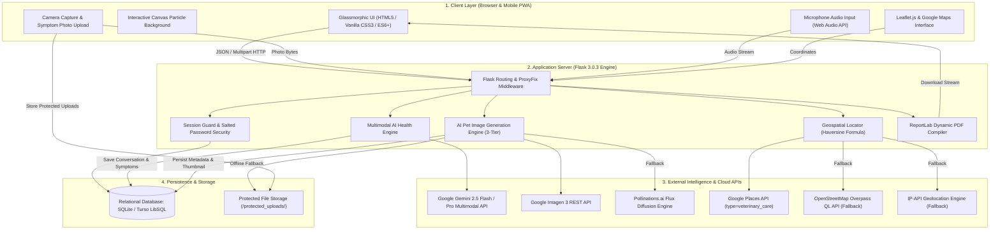
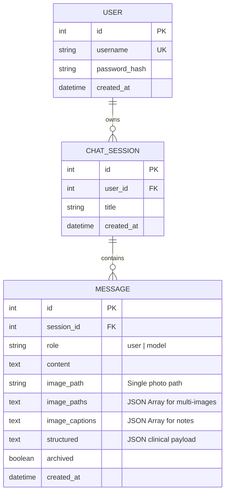

# 🐾 PAWSENSE AI — Complete Project Presentation & Exhibition Guide

---

## 📌 1. Project Title & Overview

* **Project Name**: **PAWSENSE AI**
* **Tagline**: Intelligent Pet Care, Multimodal Veterinary Triage & AI Visual Companion Platform
* **Domain**: Artificial Intelligence (Generative AI & Multimodal LLMs), Computer Vision, Geospatial Systems, Full-Stack Web Architecture
* **Target Audience**: Pet parents, veterinary clinics, animal rescue organizations, and pet healthcare providers.

---

## 🎯 2. The 30-Second Elevator Pitch (For Starting Your Presentation)

> *"Good morning / afternoon everyone. Today we present **PawSense AI**, an intelligent multimodal pet healthcare and veterinary assistance platform.*
>
> *When pets get sick during late hours or weekends, pet parents panic and struggle to describe symptoms or find open clinics. **PawSense AI** bridges this critical gap: it allows pet owners to consult an AI veterinary companion through **text, voice, or photos** in their local language, **generates custom pet visual care guides & images**, **locates the nearest emergency vet clinics on an interactive live map**, and **compiles an instant clinical PDF summary** that owners can hand over directly to their veterinarian."*

---

## 🚨 3. Problem Statement & Motivation

1. **Delayed Triage & Panic**: Pet medical emergencies occur outside clinic hours. Browsing unverified forums yields alarming or inaccurate advice.
2. **Visual Symptoms Are Hard to Articulate**: Skin rashes, ear mites, ocular discharge, and physical swellings are difficult to explain in words alone.
3. **Emergency Inaccessibility**: In critical moments, pet owners lose time calculating distances or finding open, verified clinics.
4. **Language & Literacy Barriers**: Medical jargon in English creates communication friction for pet parents who prefer regional languages.
5. **Fragmented Health History**: Pet owners struggle to recall symptom progression, timelines, and diet when finally reaching the veterinary hospital.

---

## 🏛️ 4. System Architecture & High-Level Working

PawSense operates as a **modular 4-tier full-stack Progressive Web Application (PWA)**:



---

## ⚙️ 5. The 6 Working Modules Explained

### 🩺 Module 1: Multimodal AI Pet Health Consultation & Triage (`/api/chat`)
* **How it works**: The user inputs symptoms via text or voice, optionally specifying their pet's profile (breed, age, allergies) and preferred response language (**English, हिन्दी, or ಕನ್ನಡ**).
* **AI Processing**: Flask wraps the user prompt with domain-specific veterinary triage rules. It queries **Google Gemini 2.5 Flash / Pro** with automatic failover to `gemini-flash-latest` and `gemini-2.5-pro`.
* **Output**: Delivers structured advice: potential conditions, immediate first-aid, dietary tips, and urgency stratification (*Low, Medium, High, Emergency*).

---

### 🎨 Module 2: Generative AI Pet Image Studio (`image_generator.py` & `/api/generate-image`)
* **How it works**: Users can request visual pet guides, breed illustrations, or character portraits directly through natural conversation (e.g., *"Generate an image of a golden retriever puppy"*), slash commands (`/image <prompt>`), or via the **AI Pet Image Studio** modal.
* **5 Curated Artistic Styles**:
  1. 📸 **Photorealistic** (Studio lighting, 8K fur texture, award-winning pet photography)
  2. 🐾 **Cute 3D Pixar** (Whimsical animated character style)
  3. 🎨 **Artistic Watercolor** (Delicate brushwork and soft pastel washes)
  4. 📋 **Veterinary Guide** (Clean anatomical and clinical infographic diagrams)
  5. 🌟 **Heroic / Fantasy** (Pet in miniature armor/cloak with mystical lighting)
* **3-Tier Resilient Engine**:
  * **Tier 1 (Google Imagen 3)**: Calls Google's Generative Language Imagen API when an authorized key is present.
  * **Tier 2 (Pollinations.ai Flux Diffusion)**: High-speed, zero-cost 1024×1024 diffusion model.
  * **Tier 3 (Procedural Pillow Graphic Fallback)**: Generates stylized pet badge art locally on the machine if offline, guaranteeing zero server crashes during evaluations.
* **UI Features**: Click-to-zoom **HD Lightbox viewer**, direct image download, and automatic persistence in the user's **"My Generated Images"** gallery.

---

### 👁️ Module 3: Computer Vision Health Scanner (`/api/scan`)
* **How it works**: The user captures a live photo via webcam or uploads an image of an external physical symptom (e.g., dermatological rash, lesion, ocular discharge, ear inflammation).
* **Vision Pipeline**: **Pillow (PIL)** validates dimensions and MIME types, then streams the bytes to Gemini Vision endpoints.
* **Structured Diagnostic Extraction**:
  ```json
  {
    "observations": [
      {
        "label": "Canine Dermatitis / Alopecia",
        "confidence": 0.89,
        "description": "Localized erythema and fur thinning detected around the paw/ear."
      }
    ],
    "severity": "medium",
    "recommended_action": "Schedule a veterinary consultation within 24-48 hours. Prevent scratching.",
    "confidence_overall": 0.86
  }
  ```

---

### 🏥 Module 4: Dual-Engine Geospatial Vet Clinic Finder (`/api/nearby-vets`)
* **How it works**: Obtains user coordinates via browser HTML5 Geolocation API (falls back to IP Geolocation if permission is denied).
* **Distance Calculation**: Computes exact geodesic distance using the mathematical **Haversine Formula**:
  $$\Delta\text{lat} = \text{lat}_2 - \text{lat}_1, \quad \Delta\text{lon} = \text{lon}_2 - \text{lon}_1$$
  $$a = \sin^2\left(\frac{\Delta\text{lat}}{2}\right) + \cos(\text{lat}_1)\cos(\text{lat}_2)\sin^2\left(\frac{\Delta\text{lon}}{2}\right)$$
  $$d = 2r \cdot \arcsin\left(\sqrt{a}\right) \quad (\text{where } r = 6371\text{ km})$$
* **Zero-Downtime Fallback**:
  * **Primary**: **Google Places API** (`type=veterinary_care`).
  * **Resilience Fallback**: If quota is exceeded, queries **OpenStreetMap Overpass QL** (`amenity=veterinary` within 20km).
* **Display**: Renders custom pins on Leaflet / Google Maps with direct 1-click turn-by-turn navigation.

---

### 📄 Module 5: Automated Clinical PDF Report Generator (`pdf_generator.py`, `/api/sessions/<id>/export_pdf` & `/api/message/report_pdf/<id>`)
* **How it works**: Compiles consultations into veterinary-grade medical summaries using **ReportLab Platypus** with multi-page flowable pagination, two-pass `NumberedCanvas` (displaying "Page X of Y"), and custom typography.
* **Two Export Modes**:
  1. **Full Session Consultation Report** (`/api/sessions/<id>/export_pdf`): Accessible directly from the **PDF Icon** in the chat header. Compiles the entire diagnostic exchange, patient details, symptom notes, embedded photos, and legal disclaimer.
  2. **Single Message Diagnostic Sheet** (`/api/message/report_pdf/<id>`): Accessible via the **PDF button** on any AI message bubble for instant 1-page triage handover.
* **Embedded Visuals**: Automatically sizes and embeds pet symptom photos and AI-generated diet/breed images alongside clinical captions.
* **Handover Ready**: Includes official branding, unique reference ID (`PS-{session_id}-{date}`), and a clinical veterinary disclaimer for doctor review.

---

### 🎙️ Module 6: Multilingual & Hands-Free Audio Interface (`/api/transcribe`)
* **How it works**: User speaks into the microphone; audio stream is transmitted via Web Audio API.
* **Transcription**: Processed by Gemini Multimodal Audio Transcription (with Google Cloud Speech fallback).
* **Audio Synthesis**: Native Text-to-Speech (TTS) reads AI answers aloud for hands-free convenience.

---

## 💾 6. Database Schema Design (Flask-SQLAlchemy)



---

## 🎬 7. Live Demonstration Script for Presentation Day

Follow this exact sequence for a smooth live presentation:

| Step | Action on Screen | What to Say to the Judges / Evaluators |
| :--- | :--- | :--- |
| **1. UI & Theme** | Open `http://127.0.0.1:5000/`. Toggle Light/Dark mode. | *"PawSense features a responsive glassmorphic UI with animated canvas particles and PWA capabilities, making it installable on any smartphone."* |
| **2. Multilingual Chat** | Select **Hindi** or **Kannada** from dropdown. Ask: *"What food is safe for a 2-month puppy?"* | *"PawSense removes language barriers in veterinary healthcare by delivering culturally nuanced advice in English, Hindi, and Kannada."* |
| **3. AI Image Studio** | Click the **Wand Icon** in the input bar. Pick **"Cute 3D Pixar"** and click the **"Golden Retriever Puppy"** chip. Click **Generate Image**. | *"PawSense includes a 3-tier Generative AI image studio using Google Imagen 3 and Flux diffusion. Pet parents can generate visual guides, diet plates, or character portraits with an HD Lightbox viewer and download capability."* |
| **4. Visual Scanner** | Upload a photo of a pet rash or click the camera button. | *"Using Gemini Multimodal Vision, PawSense analyzes visual indicators on the pet's skin, classifies severity, and provides immediate first-aid instructions."* |
| **5. Geospatial Vet Finder** | Click the **"Nearby Vets"** button. | *"In an emergency, advice isn't enough. PawSense calculates real-time distances using the Haversine formula and maps verified veterinary hospitals using Google Places and OpenStreetMap."* |
| **6. PDF Report** | Click **Showcase** in the gallery or **Export PDF**. | *"To maintain continuity of care, PawSense compiles the entire consultation and symptom photo into a veterinary-ready clinical PDF report using ReportLab for handover to the doctor."* |

---

## 🎓 8. Top 6 Examiner / Viva Questions & Model Answers

### Q1: Why did you choose Flask instead of Django or Node.js?
> **Answer**: *"Flask is a lightweight, asynchronous-capable micro-framework with zero boilerplate overhead. Because our platform deeply integrates native Python AI SDKs (Google Generative AI, Pillow for vision processing, and ReportLab for PDF compilation), Flask allows us to execute these pipelines natively in-process without slow IPC bridges or cross-language serialization."*

### Q2: Is PawSense trying to replace veterinarians?
> **Answer**: *"No. PawSense is explicitly engineered as a **first-response triage companion**, not a licensed medical prescriber. It stratifies urgency, provides home first-aid stabilization, and immediately routes owners to certified local hospitals. Every response contains clear clinical disclaimers."*

### Q3: How does your AI Image Generation engine work?
> **Answer**: *"We developed a **3-tier resilient architecture** in `image_generator.py`:*
> 1. *Tier 1: Calls Google Imagen 3 REST API via Google AI Studio.*
> 2. *Tier 2: Automatically falls back to Pollinations.ai Flux Diffusion for 1024×1024 high-res rendering.*
> 3. *Tier 3: Includes a local procedural Pillow graphic engine that generates custom pet badges offline, ensuring the application never crashes during an evaluation."*

### Q4: How does the system handle external API failures or rate limits?
> **Answer**: *"Resilience is implemented across every layer:*
> * *AI Triage: Cascades across model candidates (`gemini-2.5-flash` ➔ `gemini-flash-latest` ➔ `gemini-2.5-pro`).*
> * *Clinic Mapping: If Google Places API is unavailable, the backend automatically fails over to OpenStreetMap's Overpass QL API.*
> * *Authentication: If OAuth credentials aren't set, a Mock Social Login route enables offline demonstration."*
 
### Q5: How is user data and image privacy secured?
> **Answer**: *"Uploaded and generated images are saved with cryptographically secure random names (`secrets.token_hex(8)`). They are served through authenticated endpoints (`/protected_uploads/<filename>`) that verify session authorization. Database queries strictly filter by `session['user_id']`."*

### Q6: How does PawSense calculate distances to veterinary hospitals?
> **Answer**: *"We implement the **Haversine formula** in Python, which computes great-circle distances between two geographic coordinate pairs on a spherical surface, ranking results accurately by proximity."*

---

## 🔮 9. Future Scope & Roadmap

1. **IoT Smart Collar Telemetry**: Continuous streaming of pet vital signs (heart rate, body temperature, activity metrics) via BLE/MQTT.
2. **WebRTC Telemedicine Video Consults**: Direct encrypted video conferencing with licensed veterinary practitioners.
3. **Edge AI / On-Device Vision**: Running quantized TensorFlow Lite / ONNX vision models directly inside the browser for offline triage.
4. **Automated Preventive Vaccination Scheduler**: WhatsApp / SMS automated reminders based on age and immunization schedules.

---

## 🏁 10. Quick Commands to Run the Project for Your Presentation

```bash
# Step 1: Open project directory in terminal
cd c:\Users\08_11_Ramya\OneDrive\Desktop\PAWSENSE

# Step 2: Activate virtual environment
.\.venv\Scripts\activate

# Step 3: Run the Flask server
python app.py

# Step 4: Open your browser and navigate to:
# http://127.0.0.1:5000/
```

---
*Good luck with your presentation tomorrow! 🐾*
