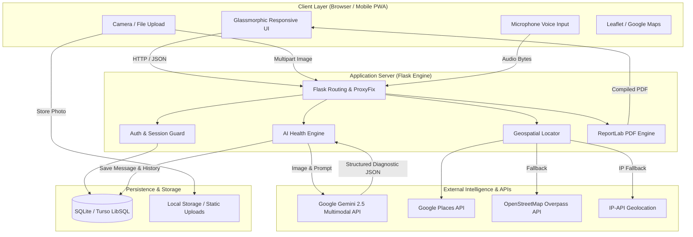

# 🐾 PAWSENSE AI — Intelligent Pet Care & Veterinary Assistance Platform
### Comprehensive Project Dossier & Technical Exhibition Guide

---

## 📌 1. Project Overview & Abstract

**PAWSENSE AI** is an advanced, full-stack, AI-powered pet healthcare and veterinary consultation platform. Designed to bridge the critical gap between anxious pet parents and timely veterinary advice, PAWSENSE combines **multimodal generative artificial intelligence**, **real-time computer vision**, **geospatial clinic mapping**, and **clinical report generation** into a responsive Progressive Web Application (PWA).

### 🎯 Elevator Pitch (For Exhibition Demonstrations)
> *"PawSense is an AI-powered veterinary companion that helps pet parents instantly triage pet illnesses through photos, voice, or text in their local language, locates the nearest emergency veterinary clinics on an interactive map, and automatically generates clinical PDF summaries that owners can hand over directly to their vet."*

---

## 🚨 2. Problem Statement & Motivation

1. **Delayed Triage & Panic**: Pet owners often face sudden health emergencies during late nights or weekends when local vet clinics are closed. Panic-searching the web often returns unreliable or alarming advice.
2. **Visual Symptoms Are Difficult to Describe**: Skin rashes, ear infections, eye discharge, or wounds are hard to explain via text alone. Pet owners need an intelligent vision system capable of inspecting visual indicators.
3. **Emergency Clinic Inaccessibility**: When immediate medical intervention is required, pet owners waste critical minutes searching for verified clinics, calculating travel distance, or looking up contact numbers.
4. **Language & Accessibility Barriers**: Traditional medical terminology can be confusing, especially for pet owners who prefer consulting in their native language (e.g., Hindi or Kannada) or prefer hands-free voice interactions.
5. **Fragmented Health Records**: When pet owners finally reach the veterinary hospital, they struggle to communicate the exact progression of symptoms, timeline, or dietary intake.

---

## 💡 3. The PawSense Solution & Key Innovations

* **Multimodal AI Medical Consultation**: Powered by Google's Gemini models (`gemini-2.5-flash`, `gemini-pro`), providing compassionate, medically-informed triage, diet suggestions, vaccine trackers, and behavior guidance.
* **Generative AI Pet Studio & Image Generation**: Users can generate photorealistic pet portraits, cute 3D Pixar-style animations, clinical veterinary diagrams, and artistic illustrations directly within the chat via natural language, `/image` slash commands, or the interactive AI Pet Image Studio modal. Supported by a 3-tier resilient architecture (Google Imagen 3 -> Flux/SDXL Diffusion -> Offline High-Fidelity Procedural Pillow Engine) with a full-screen Lightbox and persistent User Image Gallery.
* **Computer Vision Health Scanning**: Users upload or capture high-resolution pet photos. The vision pipeline analyzes symptoms (e.g., dermatological issues, swelling, lethargy indicators) and returns structured observations, severity classification, and confidence scoring.
* **Dual-Engine Geolocation Vet Locator**:
  * Primary: Google Places API for real-time clinic ratings, verified coordinates, and turn-by-turn navigation.
  * Resilience Fallback: OpenStreetMap Overpass API (free, zero-cost fallback) + IP Geolocation, ensuring zero downtime if external API limits are exceeded.
  * Custom mathematical distance calculation via the **Haversine formula**.
* **Automated Clinical PDF Report Generator**: Converts AI diagnostic conversations and scan findings into downloadable, formatted clinical consultation sheets using **ReportLab**.
* **Multilingual & Multimodal Voice Interaction**:
  * Supports localized consultations in **English, Hindi (हिन्दी), and Kannada (ಕನ್ನಡ)**.
  * Speech-to-Text via Gemini Audio Transcription & Google Cloud Speech API.
  * Native Text-to-Speech (TTS) voice synthesis for verbal answers.
* **Offline-Ready Progressive Web App (PWA)**: Installable on Android, iOS, and Desktop with background caching, service workers, and interactive canvas graphics.
* **Cloud & Serverless Ready Architecture**: Seamlessly shifts between local SQLite and cloud-scale **Turso LibSQL** database with zero code modifications for deployment on platforms like Vercel.

---

## 🛠️ 4. Detailed Technology Stack

### A. Backend Architecture
| Component | Technology / Library | Purpose & Rationale |
| :--- | :--- | :--- |
| **Core Framework** | **Python 3.10+ & Flask 3.0.3** | Lightweight, high-throughput micro-framework ideal for RESTful API orchestration and asynchronous external service streaming. |
| **Database ORM** | **Flask-SQLAlchemy 3.1.1** | Object-Relational Mapping providing abstraction over relational tables, relationships, and queries. |
| **Relational Databases** | **SQLite & Turso (LibSQL)** | Dual-database support: local file-based SQLite for standalone development, and Turso distributed edge LibSQL via `sqlalchemy-libsql` for production serverless hosting. |
| **Database Migrations** | **Alembic 1.11.1** | Schema evolution and database migration tracking. |
| **Security & Auth** | **Werkzeug 3.0.3 & Secrets** | Secure PBKDF2/SHA-256 password hashing, CSRF session tokens, proxy header sanitization (`ProxyFix`), and file name security (`secure_filename`). |
| **Document Generation** | **ReportLab 4.2.5** | High-performance dynamic PDF report compilation for medical summaries and diagnostic summaries. |
| **Image Processing** | **Pillow (PIL) >= 12.3.0** | Image resizing, validation, MIME-type verification, and byte streaming to AI vision endpoints. |
| **HTTP Client** | **Requests 2.31.0** | REST client for Overpass API, Google Places, and IP geolocation queries. |
| **Configuration** | **python-dotenv 1.0.1** | Twelve-factor application configuration managing environment variables. |

### B. Artificial Intelligence & Cloud Services
| Service / Model | Role in PAWSENSE |
| :--- | :--- |
| **Google Gemini 2.5 Flash / Pro** | Multimodal reasoning, real-time medical conversation, prompt engineering with domain guardrails, and speech audio transcription. |
| **Google Imagen 3 & Flux Diffusion Engine** | Real-time text-to-image pet portrait and clinical visual generation with 5 artistic styles, high-res download, and offline procedural Pillow rendering. |
| **Google Places API** | Location-based queries (`veterinary_care`, `hospital`) to discover nearby clinics and ratings. |
| **Google Maps JS & Leaflet.js** | Interactive mapping, markers, clinic popups, and turn-by-turn route redirects. |
| **OpenStreetMap Overpass API** | Open-source geospatial querying fallback using Overpass QL for veterinary nodes and ways. |
| **Google Cloud Speech API** | Fallback automated speech recognition (ASR) for high-accuracy voice transcription. |
| **OAuth 2.0 (Google & GitHub)** | Secure single sign-on (SSO) alongside a built-in mock fallback for offline exhibition demos. |

### C. Frontend Architecture & Design Aesthetics
| Component | Technology | Implementation Details |
| :--- | :--- | :--- |
| **Markup & Semantics** | **HTML5** | Semantic, accessible layout adhering to modern SEO and screen-reader standards. |
| **Styling & Theme** | **Vanilla CSS3** | Custom design system utilizing glassmorphism (`backdrop-filter: blur`), CSS custom properties (variables), responsive CSS Grid, and Flexbox. |
| **Interactive Logic** | **Vanilla JavaScript (ES6+)** | Zero bulky frontend frameworks (React/Vue not needed), resulting in near-instant load times, direct DOM manipulation, and streamlined event handling. |
| **Dynamic Background** | **HTML5 `<canvas>`** | Custom animated floating color orbs responding dynamically to dark/light theme state changes. |
| **Markdown Rendering** | **Marked.js** | Renders AI responses, lists, bold points, and code blocks in clean formatted typography. |
| **Icons & Typography** | **FontAwesome 6 & Google Fonts** | Typography styled with `Outfit` and `Inter`; rich iconography for intuitive pet healthcare UI. |
| **PWA Capabilities** | **Web App Manifest & Service Worker** | Standalone mobile-app feel, splash screens, and asset caching. |

---

## 🏛️ 5. System Architecture & Data Flow



---

## 💾 6. Database Schema Design

The relational database uses **Flask-SQLAlchemy** with relational integrity and cascade deletes:

### 1. `User` Model
* `id` *(Integer, Primary Key)*: Unique identifier.
* `username` *(String(50), Unique, Indexed)*: User's chosen username.
* `password_hash` *(String(255))*: Secure salted hash via Werkzeug.
* `created_at` *(DateTime)*: Account registration timestamp.
* `sessions` *(Relationship)*: One-to-many relationship with `ChatSession`.

### 2. `ChatSession` Model
* `id` *(Integer, Primary Key)*: Conversation identifier.
* `user_id` *(Integer, Foreign Key -> `user.id`)*: Owner of the conversation.
* `title` *(String(100))*: Auto-generated conversation summary (e.g. "Cat Diet Plan").
* `created_at` *(DateTime)*: Timestamp of conversation creation.
* `messages` *(Relationship)*: One-to-many relationship with `Message` (cascade delete).

### 3. `Message` Model
* `id` *(Integer, Primary Key)*: Message identifier.
* `session_id` *(Integer, Foreign Key -> `chat_session.id`)*: Parent chat thread.
* `role` *(String(20))*: `'user'` or `'model'`.
* `content` *(Text)*: The textual message or AI output.
* `image_path` *(String(255))*: Relative path to single uploaded pet image.
* `image_paths` *(Text, JSON Array)*: Array of multiple image attachments.
* `image_captions` *(Text, JSON Array)*: User notes/captions for uploaded images.
* `structured` *(Text, JSON String)*: Parsed structured clinical output from Gemini.
* `archived` *(Boolean)*: Soft-delete/retention status.
* `archive_path` *(String(255))*: Cold-storage path if archived.
* `created_at` *(DateTime)*: Timestamp.

---

## ⚡ 7. Core Modules & Step-by-Step Functionalities

### Module 1: Multimodal AI Chat & Clinical Triage (`/api/chat`)
1. User enters symptoms via text or voice, optionally uploading 1 or more photos.
2. System attaches custom domain instructions:
   * Sets medical tone and emergency safety alerts.
   * Enforces selected output language (**English, Hindi, Kannada**).
   * Appends user personalization settings (e.g., pet breed, age, allergies).
3. Payload is passed to **Google Gemini 2.5 Flash / Pro**.
4. Response is parsed for structured medical advice (Symptoms, Immediate First-Aid, Diet Advice, Urgency Level).
5. Chat title is automatically derived from the initial query.

### Module 2: Computer Vision Pet Health Scanner (`/api/scan`)
1. Accepts pet image taken via webcam or mobile camera.
2. Directs Gemini Vision model with a specialized medical extraction prompt:
   ```json
   {
     "observations": [{"label": "Alopecia / Dermatitis", "confidence": 0.88, "description": "Redness and localized hair loss observed around ear margin"}],
     "severity": "medium",
     "recommended_action": "Consult a veterinarian within 24-48 hours. Prevent pet from scratching.",
     "confidence_overall": 0.85,
     "tags": ["dermatology", "skin-irritation", "canine"]
   }
   ```
3. Creates a persistent JSON diagnostic report in `static/reports/`.
4. Triggers coordinate-based search for nearest veterinary facilities.

### Module 3: Geospatial Vet Clinic Finder (`/api/nearby-vets`)
1. Gathers client coordinates (`lat`, `lon`) via browser HTML5 Geolocation API.
2. If GPS is blocked or unavailable, falls back to IP-based approximate geolocation.
3. Queries Google Places API for `type=veterinary_care` ranked by proximity.
4. If Google API is unreachable, queries OpenStreetMap's Overpass API (`amenity=veterinary` within 20km radius).
5. Computes exact distance using the **Haversine Formula**:
   $$d = 2r \arcsin\left(\sqrt{\sin^2\left(\frac{\Delta \text{lat}}{2}\right) + \cos(\text{lat}_1)\cos(\text{lat}_2)\sin^2\left(\frac{\Delta \text{lon}}{2}\right)}\right)$$
6. Renders pins on Leaflet / Google Maps with direct Google Maps turn-by-turn navigation links.

### Module 4: Dynamic PDF Medical Report Generator (`/api/message/report_pdf/<id>`)
1. Synthesizes chat transcripts and scan findings.
2. Utilizes **ReportLab** to build a formatted, printable document containing:
   * Pet owner details and timestamp.
   * High-resolution embedded pet symptom photo.
   * Clinical triage breakdown and severity score.
   * Actionable immediate care instructions.
   * List of closest local emergency clinics with contact info.
3. Streams the PDF directly to the browser for instant download or printing.

### Module 5: Speech & Audio Interface (`/api/transcribe`)
1. User clicks the microphone button; browser records audio snippet via Web Audio API.
2. Audio stream is transmitted via Base64/multipart to `/api/transcribe`.
3. Server submits audio directly to Gemini Multimodal Audio Transcription, with secondary fallback to Google Cloud Speech API.
4. Converted text automatically populates the chat box and initiates AI consultation.

---

## 🚀 8. College Exhibition Live Demo Script (Step-by-Step)

When presenting to professors, external evaluators, and exhibition attendees, follow this 4-step demonstration flow:

### Step 1: The Visual First Impression (30 Seconds)
* **Action**: Open the landing page at `http://127.0.0.1:5000/`.
* **Talk Track**:
  > *"Welcome to PawSense AI. As you can see, the interface is built with modern glassmorphism aesthetics and an interactive background canvas. It is fully responsive and functions as a Progressive Web App (PWA) installable on any smartphone."*
* **Feature to Show**: Toggle between **Dark Mode** and **Light Mode** using the theme switch on the top right.

### Step 2: Instant Multimodal Diagnosis (60 Seconds)
* **Action**: Click the camera icon or attach a sample image of a pet with a skin issue or eye irritation. Type or speak: *"My golden retriever has a red rash near his paw and keeps licking it."*
* **Talk Track**:
  > *"Here, PawSense utilizes Gemini 2.5's multimodal vision capabilities. Instead of generic search results, it evaluates the visual markers on the pet's skin, factors in the breed behavior, and delivers structured advice with safety classifications."*
* **Feature to Show**: Switch the language dropdown to **हिन्दी (Hindi)** or **ಕನ್ನಡ (Kannada)** and ask a question to showcase regional accessibility.

### Step 3: Location-Aware Veterinary Emergency Locator (45 Seconds)
* **Action**: Click the **"Nearby Vets"** button or quick-action chip.
* **Talk Track**:
  > *"In an emergency, advice isn't enough—care is needed. PawSense immediately queries geolocation coordinates, computes real-time road distances using the Haversine algorithm, and displays nearby veterinary hospitals on Leaflet and Google Maps with direct routing."*
* **Technical Highlight to Mention**:
  > *"Notice our dual-tier fallback architecture: if Google Places reaches quota or goes offline, our system automatically switches to the OpenStreetMap Overpass engine."*

### Step 4: Medical Report Export (30 Seconds)
* **Action**: Click the **"Export Clinical PDF Report"** button on an AI assessment.
* **Talk Track**:
  > *"To ensure continuity of care, PawSense compiles the AI assessment, symptom photographs, and clinic recommendations into a clean, veterinary-ready clinical PDF report using ReportLab, ready to hand over to a doctor."*

---

## 🎓 9. Frequently Asked Questions (Viva / Examiner Questions & Answers)

### Q1: Is PawSense replacing professional veterinarians?
> **Answer**: No. PawSense acts as a **first-response triage companion**, not a licensed medical prescriber. It provides immediate first-aid, symptom clarification, urgency stratification (low, medium, high, emergency), and directly routes pet parents to certified local clinics. Every response includes clinical disclaimers.

### Q2: Why did you choose Flask instead of Django or Node.js?
> **Answer**: Flask provides a lightweight, minimalist micro-framework architecture. Unlike Django, which imposes heavy monolith overhead, Flask allowed us to integrate custom database engines (Turso LibSQL for serverless Vercel deployments alongside standard SQLite), native Python AI SDKs (Google Generative AI, PIL, ReportLab) without IPC bridges, and maintain sub-millisecond response dispatch times.

### Q3: How do you handle external API failures or rate limits?
> **Answer**: Resilience is built into every layer:
> 1. **AI Models**: The system cascades across model candidates (`gemini-2.5-flash` ➔ `gemini-flash-latest` ➔ `gemini-2.5-pro`).
> 2. **Maps & Vets**: If Google Places API is unavailable, the backend queries OpenStreetMap Overpass API without user interruption.
> 3. **Speech**: Gemini audio transcription falls back to Google Cloud Speech API.
> 4. **Authentication**: If OAuth provider credentials aren't configured, a built-in Mock Social Login route allows offline demonstration without network failure.

### Q4: How is user data and image privacy maintained?
> **Answer**: Uploaded pet photos are stored under protected hashed filenames (`secrets.token_hex(8)_filename`) and served through a protected endpoint (`/protected_uploads/<filename>`) verifying user session authorization. Database queries strictly filter by `session['user_id']`. Furthermore, an automated retention cleanup scheduler deletes temporary diagnostic files after configurable expiration periods.

### Q5: How does the application scale for serverless cloud deployment?
> **Answer**: The application includes native Vercel configuration (`vercel.json` and `api/index.py`). In serverless environments, local disk writes redirect safely to `/tmp/`, and relational data shifts seamlessly to **Turso's cloud-distributed LibSQL database** over HTTPS/libsql protocol.

---

## 🔮 10. Future Scope & Roadmap

1. **IoT Smart Collar Integration**: Streaming real-time pet biometrics (heart rate, body temperature, activity levels) via BLE/MQTT into the PawSense diagnostic dashboard.
2. **Telemedicine Video Consultations**: WebRTC-based direct video calls connecting pet owners directly to verified local veterinarians.
3. **Edge AI / On-Device Vision**: Running quantized lightweight vision models (TensorFlow Lite / ONNX) directly inside the browser for offline triage without requiring internet connectivity.
4. **Automated Vaccination & Deworming Reminders**: WhatsApp / SMS automated notification triggers based on the pet's age and vaccination schedule.

---

## 🏁 11. Quick Execution Guide (To Run the Project)

```bash
# 1. Activate virtual environment
.venv\Scripts\activate

# 2. Install dependencies (if not already installed)
pip install -r requirements.txt

# 3. Configure environment keys in .env
# Ensure GOOGLE_API_KEY is present for Gemini AI
# Optional: GOOGLE_BROWSER_KEY and GOOGLE_SERVER_KEY for Google Maps

# 4. Start the application
python app.py

# 5. Access the app in your browser
# Open: http://127.0.0.1:5000
```

---
*Created for College Exhibition & Academic Presentation | PAWSENSE AI Project Documentation*
